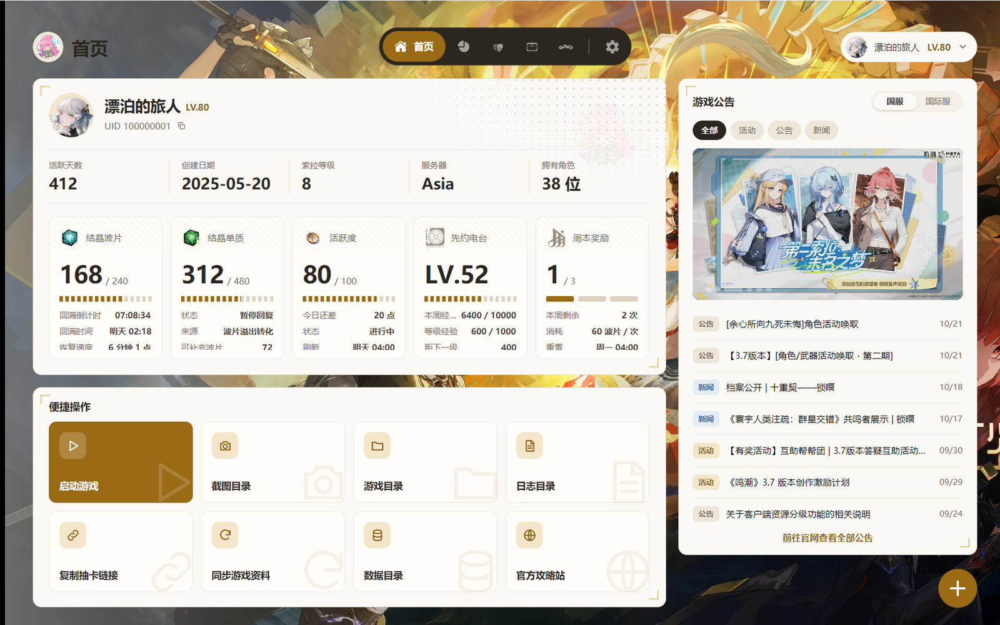
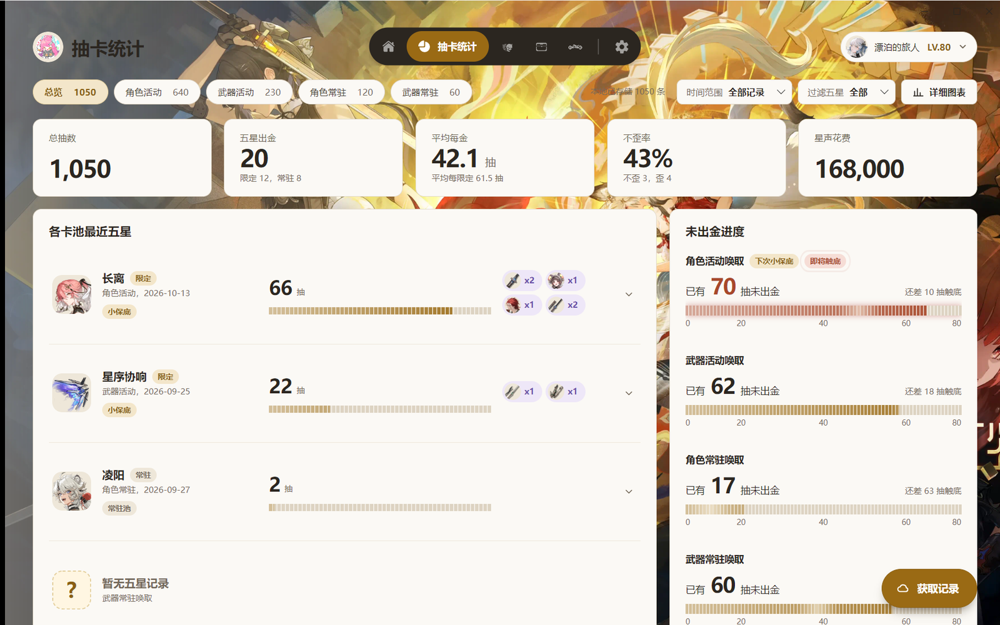
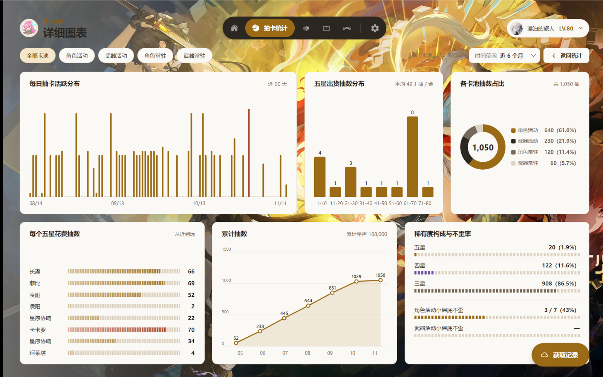
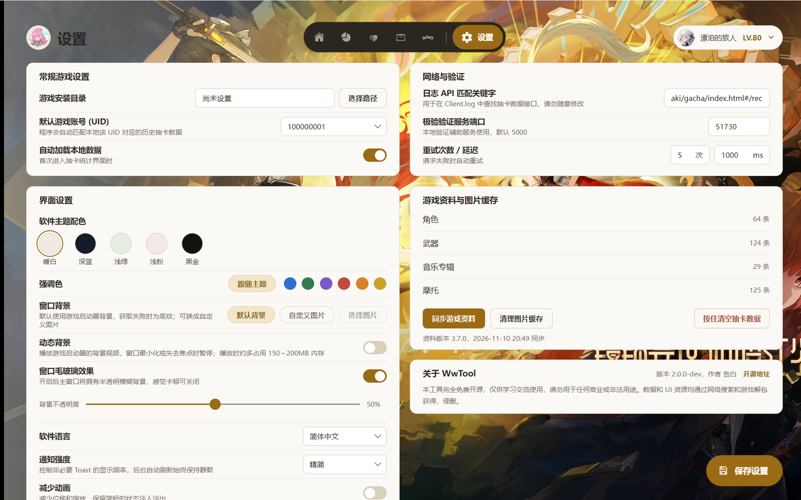

<div align="center">


## WwTool

鸣潮工具箱 · 账号资料、角色详情与抽卡统计


[](LICENSE.txt)

简体中文 | [English](docs/README_en.md) | [日本語](docs/README_ja.md)

[功能](#features) · [下载](#download) · [快速上手](#quick-start) · [数据与隐私](#data) · [已知限制](#limitations) · [文档](#docs) · [更新日志](CHANGELOG.md)

</div>

《鸣潮》的 Windows 桌面工具：查看账号资料和角色，整理并统计抽卡记录，所有数据保存在本地。支持多账号、多 UID，界面有简体中文、英文和日文。



<a id="features"></a>
## 功能

| 页面 | 内容 |
| --- | --- |
| 首页 | 昵称、UID（可一键复制）、等级与索拉等级；结晶波片、结晶单质、活跃度、先约电台和周本奖励的实时进度；启动游戏、打开截图 / 游戏 / 日志目录、复制抽卡链接等便捷操作；游戏公告（国服 / 国际服切换） |
| 活动 | 当前版本与剩余时间；卡池与活动时间线、游戏内版本日历图、全部游戏内公告与正文；5 星 UP；国服前瞻兑换码一键复制；逆境深塔、冥歌海墟、终焉矩阵当期的敌人、增益与评分规则 |
| 抽卡统计 | 自动从游戏日志找到抽卡链接，获取并保存记录；总览看各卡池抽数、出金、平均每金、不歪率和已垫抽数，可切换列表、精简或时间线视图（五星按时间排列，按抽数标出欧非）；每个卡池单独查看全部记录 |
| 详细图表 | 五星出货抽数分布、各卡池抽数占比、每个五星的花费、稀有度构成与不歪率、每日抽卡热力图 |
| 账号数据 | 本地保存的所有账号，切换、刷新、重新登录或删除 |
| 角色数据 | 已拥有的角色和武器，共鸣链与当前装备；点击角色卡打开角色详情：立绘、技能倍率、共鸣链、故事与语音台词，以及自己的养成与抽取记录 |
| 探索数据 | 各类奇藏箱、潮汐之遗的收集数量 |
| 摩托数据 | 载具等级，皮肤、贴纸、挂饰、车架与车载音乐的解锁情况 |
| 设置 | 主题与强调色、启动器背景 / 动态背景 / 自定义图片、毛玻璃、语言、通知强度、减少动画、日志与网络选项 |

> [!NOTE]
> 账号资料（首页、角色、探索、摩托）目前只支持**国际服**，需要用邮箱和密码登录。抽卡统计国服、国际服都支持，不登录也能单独使用。

<details>
<summary>更多截图</summary>






</details>

<a id="download"></a>
## 下载

到 [Releases](https://github.com/conFess233/WwTool/releases) 下载其中一个压缩包。不确定选哪个就用第一个。

| 压缩包 | 运行时 | 图标 | 大小 | 适合 |
| --- | --- | --- | --- | --- |
| `WwTool-<版本>-win-x64-single-runtime.zip` | 自带 | 自带 | 约 75 MB | 不想另装 .NET，解压就用 |
| `WwTool-<版本>-win-x64-single.zip` | 需另装 | 自带 | 约 44 MB | 已装 .NET 10 桌面运行时 |
| `WwTool-<版本>-win-x64-single-lite.zip` | 需另装 | 用到时下载 | 约 17 MB | 已装运行时，想要最小的下载 |
| `WwTool-<版本>-win-x64-multi-runtime.zip` | 自带 | 自带 | 约 78 MB | 与上面对应的单文件版功能相同，依赖库放在 exe 旁边 |
| `WwTool-<版本>-win-x64-multi.zip` | 需另装 | 自带 | 约 44 MB | |
| `WwTool-<版本>-win-x64-multi-lite.zip` | 需另装 | 用到时下载 | 约 17 MB | |

- **运行时**：标「需另装」的包要先安装 [.NET Desktop Runtime 10（Windows x64）](https://dotnet.microsoft.com/zh-cn/download/dotnet/10.0)，在下载页选「桌面运行时」。
- **单文件 / 多文件**：每个压缩包解压后都是一个 `WwTool` 文件夹。单文件版的文件夹里只有 `WwTool.exe`、`Local` 目录和 `portable` 标记文件；多文件版把依赖库放在 exe 旁边。两者功能相同。
- **Lite**：不带角色、武器等图标（`Local/Icons`），第一次显示时从本仓库下载并缓存，之后离线也能看。
- 每个版本附有 `SHA256SUMS.txt`，可用于校验下载是否完整。

要求 Windows 10 或以上的 x64 系统。

<a id="quick-start"></a>
## 快速上手

1. 把压缩包解压到一个可写的位置（不要放在 `C:\Program Files` 下），打开解压出的 `WwTool` 文件夹，运行 `WwTool.exe`。
2. **只看抽卡记录**：在游戏里打开一次「唤取 → 历史记录」，回到 WwTool 的抽卡统计页点「获取记录」。程序会从游戏日志里找链接；找不到时会弹出窗口让你粘贴链接。第一次使用前，建议先在设置里选好游戏安装目录。
3. **看账号资料（国际服）**：在首页点「添加游戏账号」，用邮箱和密码登录；需要安全验证时会打开网页，完成后自动继续。

每一步的详细说明、截图和常见问题见 [使用帮助](docs/Help.md)。

<details>
<summary>从源码编译</summary>

安装 [.NET 10 SDK](https://dotnet.microsoft.com/zh-cn/download/dotnet/10.0)，在 Windows 上执行：

```powershell
git clone https://github.com/conFess233/WwTool.git
cd WwTool
dotnet build src/UI/WwTool.UI.csproj -c Release
```

运行 `src/UI/bin/Release/net10.0/WwTool.exe`。也可以用支持 .NET 10 的 IDE 打开 `WwTool.slnx`。

生成上面 6 个发布包：

```powershell
powershell -ExecutionPolicy Bypass -File scripts/publish.ps1
```

压缩包和 `SHA256SUMS.txt` 输出到 `publish/`。只打其中几个时加 `-Only single,single-lite`。

</details>

<a id="data"></a>
## 数据与隐私

- **数据保存在程序目录**（压缩包里的 `portable` 文件就是这个开关，请不要删除）：
  - `Config/`：设置
  - `Local/Data/LocalData.db`：账号快照、抽卡记录和登录凭据
  - `Local/Cache/`：图片、启动器背景与公告缓存，可以随时删除
  - `Local/Logs/`：运行日志
- **更新**：有新版本时程序会提示，可以在程序里直接「下载并更新」（详见[使用帮助](docs/Help.md#data)）。手动更新时，退出程序，把新压缩包解压到原 `WwTool` 文件夹所在的位置，覆盖同名文件即可。发布包里不含数据库和设置，不会覆盖你的数据。保险起见，更新前可以先复制一份 `Config` 和 `Local/Data`。1.x 的程序目录也可以直接解压覆盖，存档会继续使用。
- **登录凭据**用 Windows DPAPI 按当前 Windows 用户加密保存。换电脑或换 Windows 用户后需要重新登录。数据库的其他内容没有加密。
- **联网**：
  - 登录和账号资料访问库洛的游戏服务；抽卡记录访问对应区服的抽卡接口。
  - 游戏资料和缺失的图标从本仓库同步；角色立绘来自官方攻略站。
  - 首页背景和公告来自游戏启动器的公开接口；活动页的游戏内公告和版本日历来自游戏的公告接口，前瞻兑换码来自库街区官方帖子，深塔 / 海墟 / 矩阵与角色详情的资料来自第三方网站 encore.moe（游戏解包数据）。
- **抽卡链接里带有你的认证信息**。反馈问题时，请隐去密码、完整的抽卡链接和其他个人信息。

<a id="limitations"></a>
## 已知限制

- **抽卡记录只能取到最近 6 个月**：这是官方接口的限制。定期获取一次，旧记录就会一直留在本地；从没获取过、又已超过 6 个月的记录无法找回。重复获取不会重复计数。
- **账号资料只显示接口返回的内容**：没有完整的角色面板和声骸词条，探索数量也不等于地图探索度。拿不到的值显示为未知，不会当作 0。
- **网络或接口变化可能导致获取失败**：游戏资料、图片、背景或公告更新失败时，会继续使用上次成功的数据，稍后可以重试。
- **动态背景**播放时大约多占 150～200 MB 内存，默认关闭。窗口最小化或失去焦点时会暂停。

<a id="docs"></a>
## 文档与反馈

- [使用帮助](docs/Help.md)
- [更新日志](CHANGELOG.md)
- 接口整理：[鸣潮 API](docs/API/WW_API.md) · [攻略站](docs/API/Guide.md) · [游戏启动器](docs/API/Launcher.md) · [游戏内公告](docs/API/GameNotice.md) · [库街区帖子](docs/API/KuroBBS_Post.md) · [encore.moe](docs/API/Encore.md)
- 资料说明：[角色](docs/Resource/Characters.md) · [武器](docs/Resource/Weapons.md) · [摩托](docs/Resource/Motorcycle.md) · [同步规则](docs/Resource/CatalogSync.md)

遇到问题请提交 [Issue](https://github.com/conFess233/WwTool/issues)。

## 许可证

[MIT License](LICENSE.txt)
