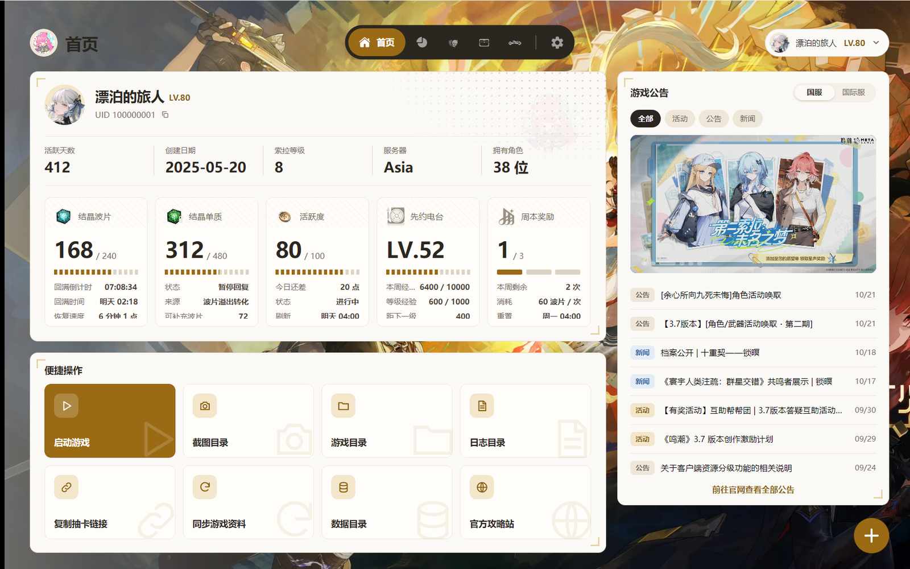
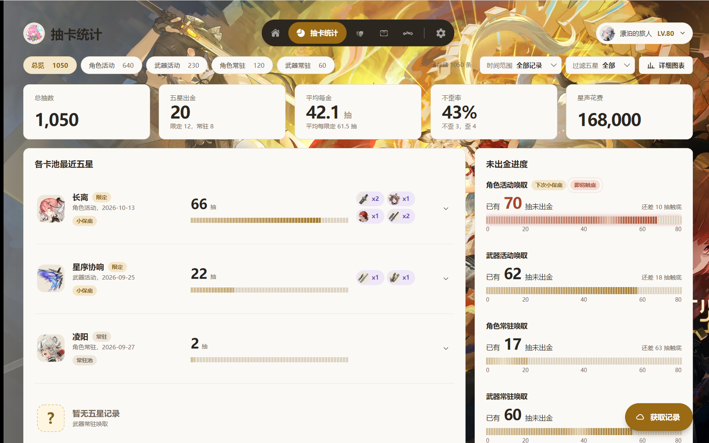
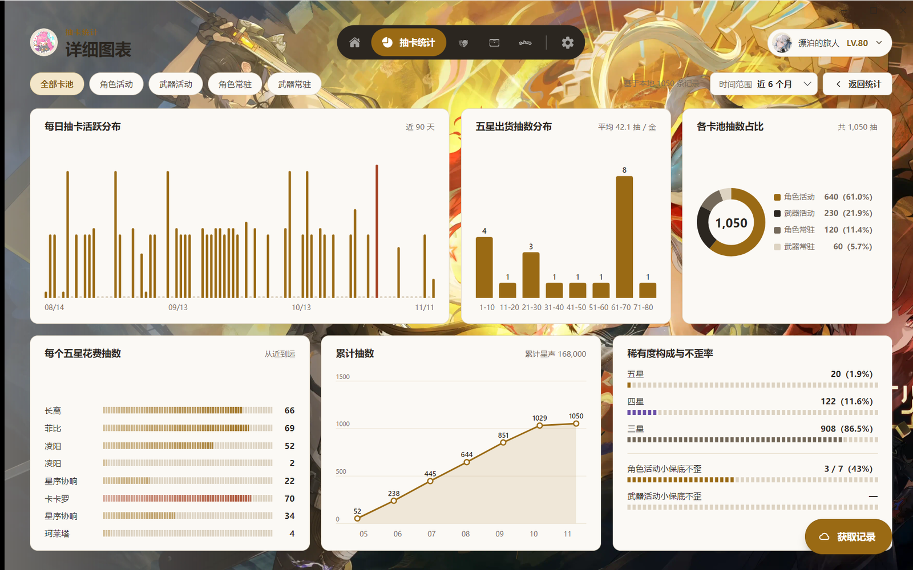
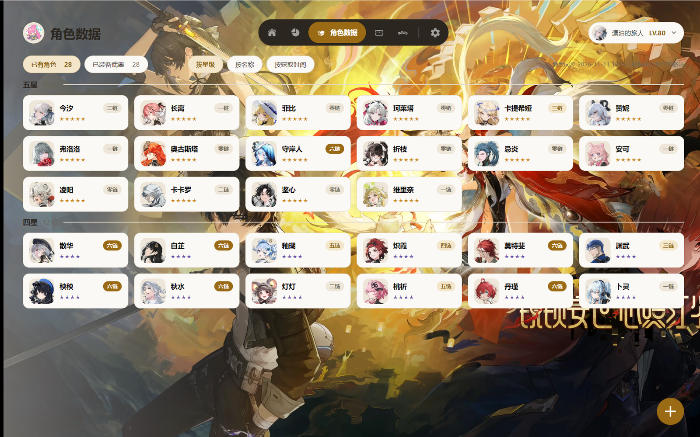
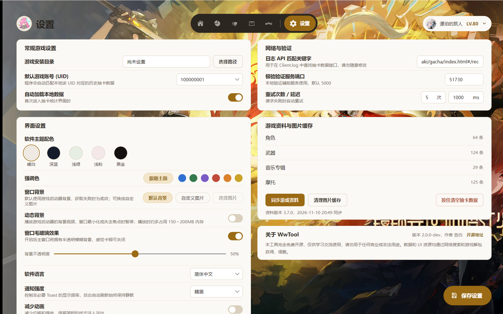

<div align="center">


## WwTool

A Wuthering Waves toolbox · Account data, Resonators and Convene statistics


[](../LICENSE.txt)

[简体中文](../README.md) | English | [日本語](README_ja.md)

[Features](#features) · [Download](#download) · [Quick start](#quick-start) · [Data & privacy](#data) · [Known limitations](#limitations) · [Docs](#docs) · [Changelog](../CHANGELOG.md)

</div>

A Windows desktop tool for Wuthering Waves: view your account and Resonators, and keep and analyze your Convene history. All data is stored locally. Supports multiple accounts and UIDs, with Simplified Chinese, English and Japanese interfaces.



<a id="features"></a>
## Features

| Page | What it shows |
| --- | --- |
| Home | Nickname, UID (one-click copy), level and SOL3 Phase; live progress of Waveplate, Crystal Solvent, Activity, Pioneer Podcast and weekly rewards; quick actions such as launching the game, opening the screenshot / game / log folders and copying the gacha link; game announcements (China / International switch) |
| Events | Current version and time left; a timeline of banners and events, the in-game version calendar, and every in-game notice with its full text; featured 5-stars; one-click copy of China livestream codes; this season of Tower of Adversity, Whimpering Wastes and Endstate Matrix with enemies, buffs and scoring |
| Convene Statistics | Finds the Convene link in the game log automatically, then fetches and saves your records. The overview shows pulls, 5-stars, average pulls per 5-star, 50/50 win rate and current pity for each banner, in list, compact or timeline view (5-stars in time order, colored by how lucky each pull was). Each banner also has its own full record list |
| Detailed charts | 5-star pity distribution, share of pulls by banner, pulls spent on each 5-star, rarity breakdown with 50/50 win rate, and a daily pull heatmap |
| Account Data | Every locally saved account: switch, refresh, log in again or delete |
| Character Data | Owned Resonators and weapons, Resonance Chains and current equipment; click a card for Resonator details: art, skill multipliers, Resonance Chain, stories and voice lines, plus your own build and pull history |
| Exploration Data | Collected chests and Tidal Remnants by tier |
| Vehicle Data | Vehicle level, and unlocked skins, stickers, ornaments, frames and in-vehicle music |
| Settings | Theme and accent color, launcher background / animated background / custom image, glass effect, language, notification level, reduced motion, logging and network options |

> [!NOTE]
> Account data (Home, Character, Exploration and Vehicle) currently supports the **International** server only, and requires logging in with email and password. Convene statistics support both the China and International servers and work without logging in.

<details>
<summary>More screenshots</summary>






</details>

The screenshots use the Simplified Chinese interface and made-up demo data.

<a id="download"></a>
## Download

Download one of the archives from [Releases](https://github.com/conFess233/WwTool/releases). If unsure, take the first one.

| Archive | Runtime | Icons | Size | Best for |
| --- | --- | --- | --- | --- |
| `WwTool-<version>-win-x64-single-runtime.zip` | Included | Included | ~75 MB | No separate .NET install; unzip and run |
| `WwTool-<version>-win-x64-single.zip` | Install separately | Included | ~44 MB | .NET 10 Desktop Runtime already installed |
| `WwTool-<version>-win-x64-single-lite.zip` | Install separately | Downloaded when needed | ~17 MB | Runtime installed, smallest download |
| `WwTool-<version>-win-x64-multi-runtime.zip` | Included | Included | ~78 MB | Same as the matching single-file build, with libraries next to the exe |
| `WwTool-<version>-win-x64-multi.zip` | Install separately | Included | ~44 MB | |
| `WwTool-<version>-win-x64-multi-lite.zip` | Install separately | Downloaded when needed | ~17 MB | |

- **Runtime**: for archives marked "Install separately", install the [.NET Desktop Runtime 10 (Windows x64)](https://dotnet.microsoft.com/en-us/download/dotnet/10.0) first. Pick the "Desktop Runtime" on the download page.
- **Single-file / multi-file**: every archive unzips to a single `WwTool` folder. In a single-file build that folder holds just `WwTool.exe`, the `Local` folder and the `portable` marker file; a multi-file build keeps its libraries next to the exe. Both work the same.
- **Lite**: leaves out the Resonator, weapon and other icons (`Local/Icons`). Each icon is downloaded from this repository the first time it is shown, then cached so it also works offline.
- Each release includes `SHA256SUMS.txt` for checking your download.

Requires 64-bit Windows 10 or later.

<a id="quick-start"></a>
## Quick start

1. Unzip the archive somewhere you can write to (not under `C:\Program Files`), open the `WwTool` folder it creates, and run `WwTool.exe`.
2. **Convene records only**: in the game, open **Convene → History** once. Back in WwTool, go to Convene Statistics and click **Get records**. WwTool looks for the link in the game log; if it can't find one, it asks you to paste the link. Before your first use, set the game installation directory in Settings.
3. **Account data (International)**: on Home, click **Add Game Account** and log in with your email and password. If a security check is needed, a web page opens; login continues once you complete it.

For step-by-step instructions and troubleshooting, see the [User guide](Help_en.md).

<details>
<summary>Build from source</summary>

Install the [.NET 10 SDK](https://dotnet.microsoft.com/en-us/download/dotnet/10.0), then on Windows run:

```powershell
git clone https://github.com/conFess233/WwTool.git
cd WwTool
dotnet build src/UI/WwTool.UI.csproj -c Release
```

Run `src/UI/bin/Release/net10.0/WwTool.exe`, or open `WwTool.slnx` in an IDE that supports .NET 10.

To build the six release archives above:

```powershell
powershell -ExecutionPolicy Bypass -File scripts/publish.ps1
```

The archives and `SHA256SUMS.txt` are written to `publish/`. Add `-Only single,single-lite` to build only some of them.

</details>

<a id="data"></a>
## Data & privacy

- **Data is stored in the program folder.** The `portable` file in the archive turns this on; don't delete it.
  - `Config/`: settings
  - `Local/Data/LocalData.db`: account snapshots, Convene records and login credentials
  - `Local/Cache/`: cached images, launcher background and announcements; safe to delete at any time
  - `Local/Logs/`: logs
- **Updating**: WwTool tells you when a new version is out and can download and install it for you (see the [User guide](Help_en.md#data)). To update by hand, close WwTool and unzip the new archive to the place that holds your existing `WwTool` folder, overwriting files with the same name. Release archives contain no database or settings, so your data is not overwritten. To be safe, you can copy `Config` and `Local/Data` first. A 1.x program folder can be updated the same way, and its records keep working.
- **Login credentials** are encrypted with Windows DPAPI for the current Windows user. After moving to another PC or Windows user you need to log in again. The rest of the database is not encrypted.
- **Network access**:
  - Login and account data use Kuro Games' services; Convene records use the gacha API of the matching server.
  - Game data and missing icons are synced from this repository; Resonator art comes from the official guide site.
  - The background and announcements on Home come from the game launcher's public API. The in-game notices and version calendar on Events come from the game's notice API, and livestream codes come from the official Kuro BBS post. Tower / Wastes / Matrix data and Resonator details come from the third-party site encore.moe (datamined).
- **Your Convene link contains authentication data.** When reporting an issue, remove your password, the full Convene link and other personal details.

<a id="limitations"></a>
## Known limitations

- **Convene records only go back 6 months.** This is a limit of the official API. Fetch regularly and older records stay in your local data; records older than 6 months that were never fetched cannot be recovered. Fetching again never counts a pull twice.
- **Account data only shows what the API returns.** There is no full character panel or Echo stats, and exploration counts are not the in-game exploration percentage. Missing values are shown as unknown, never as 0.
- **Network or API changes can cause fetches to fail.** If game data, images, the background or announcements fail to update, the last successful data is kept; try again later.
- **The animated background** uses about 150–200 MB of extra memory while playing and is off by default. It pauses when the window is minimized or loses focus.

<a id="docs"></a>
## Docs & feedback

- [User guide](Help_en.md)
- [Changelog](../CHANGELOG.md) (Chinese)
- API notes (Chinese): [Wuthering Waves API](API/WW_API.md) · [Guide site](API/Guide.md) · [Game launcher](API/Launcher.md) · [In-game notices](API/GameNotice.md) · [Kuro BBS posts](API/KuroBBS_Post.md) · [encore.moe](API/Encore.md)
- Data notes (Chinese): [Resonators](Resource/Characters.md) · [Weapons](Resource/Weapons.md) · [Vehicle](Resource/Motorcycle.md) · [Sync rules](Resource/CatalogSync.md)

Found a problem? Open an [Issue](https://github.com/conFess233/WwTool/issues).

## License

[MIT License](../LICENSE.txt)
