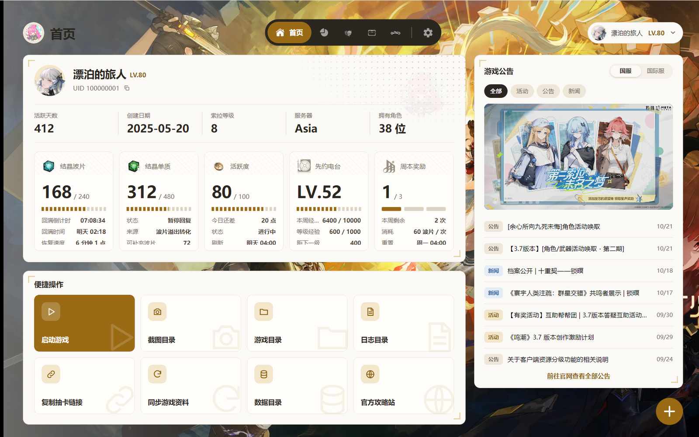
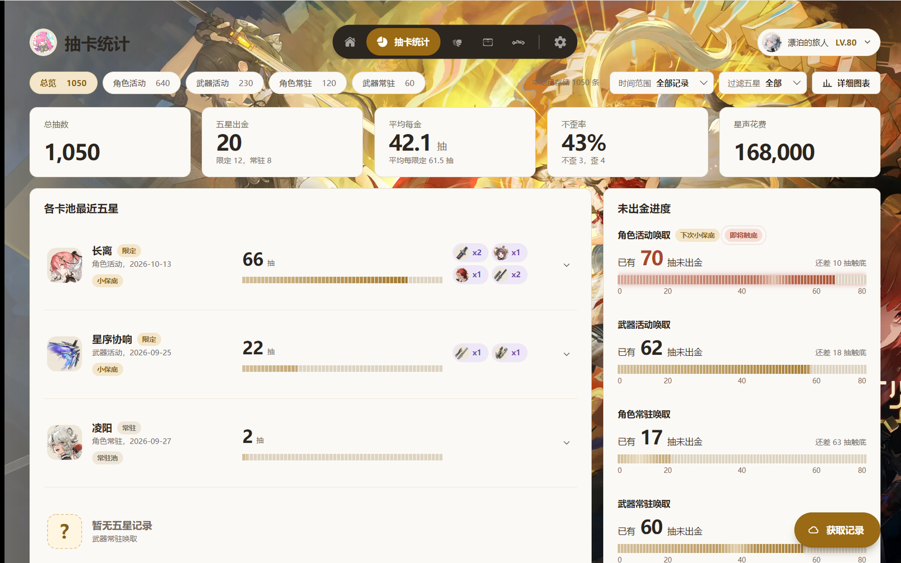
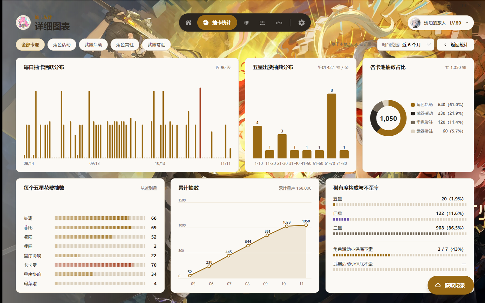
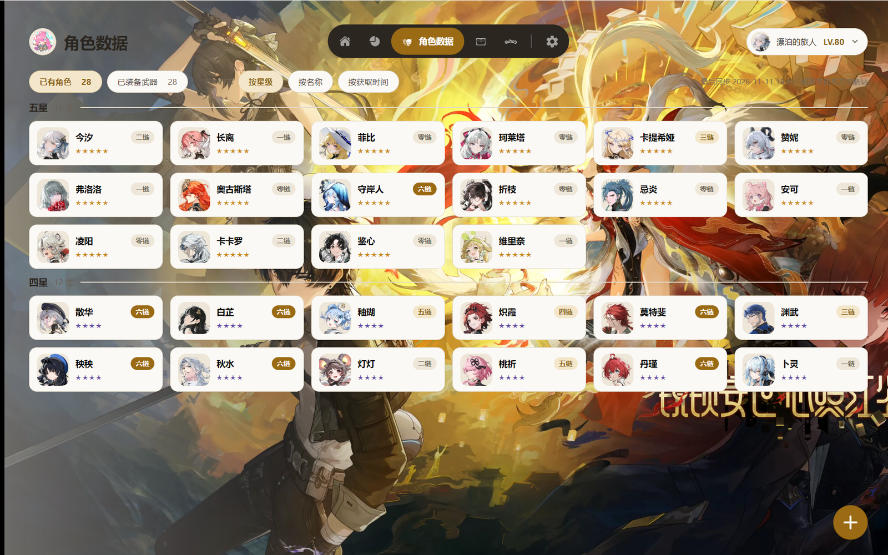
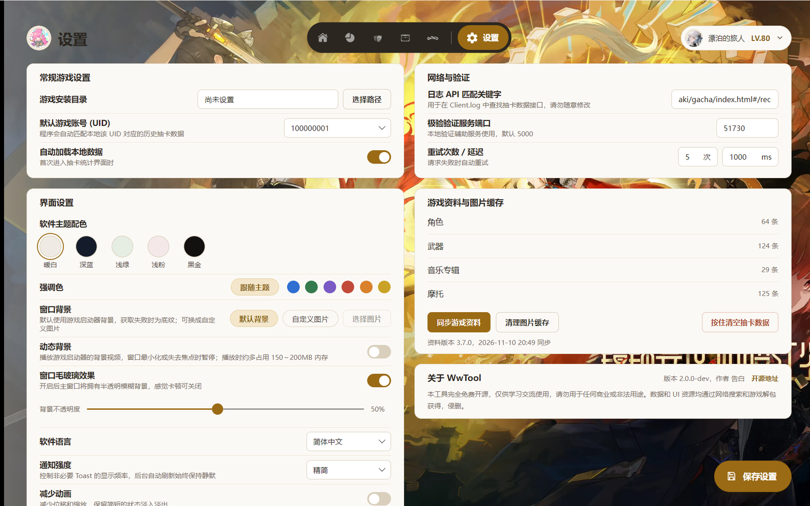

<div align="center">


## WwTool

鳴潮ツールボックス · アカウント情報、キャラクター、集音統計


[](../LICENSE.txt)

[简体中文](../README.md) | [English](README_en.md) | 日本語

[機能](#features) · [ダウンロード](#download) · [クイックスタート](#quick-start) · [データとプライバシー](#data) · [既知の制限](#limitations) · [ドキュメント](#docs) · [更新履歴](../CHANGELOG.md)

</div>

『鳴潮』用の Windows デスクトップツールです。アカウント情報とキャラクターを確認し、集音（ガチャ）記録を保存・集計できます。データはすべてローカルに保存されます。複数アカウント・複数 UID に対応し、簡体字中国語・英語・日本語の UI を備えています。



<a id="features"></a>
## 機能

| ページ | 内容 |
| --- | --- |
| ホーム | ニックネーム、UID（ワンクリックでコピー）、レベルと SOL3 フェーズ。結晶波長板・結晶溶媒・活躍度・先駆ラジオ・週ボス報酬のリアルタイム進捗。ゲーム起動、スクリーンショット / ゲーム / ログフォルダを開く、ガチャリンクのコピーなどのクイック操作。ゲームのお知らせ（中国版 / 国際版の切り替え） |
| イベント | 現在のバージョンと残り時間。集音とイベントのタイムライン、ゲーム内のバージョンカレンダー、すべてのゲーム内お知らせと本文。星5ピックアップ。中国版の生放送シリアルコードをワンクリックでコピー。逆境深塔・冥歌海墟・終焉マトリクスの今期の敵、バフ、スコア条件 |
| 集音統計 | ゲームログから集音リンクを自動で探し、記録を取得して保存します。概要では各バナーの回数、★5 獲得数、平均星5排出回数、すり抜けなし率、現在の天井カウントをリスト表示、コンパクト表示、タイムライン表示（★5 を時系列に並べ、運の良さで色分け）で確認できます。バナーごとに全記録も見られます |
| 詳細グラフ | ★5 排出回数の分布、バナー別の回数比率、★5 ごとの消費回数、レアリティ構成とすり抜けなし率、日別のガチャヒートマップ |
| アカウントデータ | ローカルに保存したすべてのアカウント。切替、更新、再ログイン、削除 |
| キャラクターデータ | 所持キャラクターと武器、共鳴チェーンと装備中の武器。カードをクリックするとキャラクター詳細（立ち絵、スキル倍率、共鳴チェーン、ストーリーとボイスのセリフ、自分の育成状況と獲得履歴）を表示 |
| 探索データ | 宝箱と潮汐の遺産の種類別の取得数 |
| バイクデータ | バイクのレベル、スキン・ステッカー・ペンダント・フレーム・車載音楽の解放状況 |
| 設定 | テーマとアクセントカラー、ランチャー背景 / 動く背景 / カスタム画像、すりガラス効果、言語、通知レベル、モーション軽減、ログとネットワークの設定 |

> [!NOTE]
> アカウント情報（ホーム・キャラクター・探索・バイク）は現在**国際版**のみ対応で、メールアドレスとパスワードでのログインが必要です。集音統計は中国版・国際版の両方に対応し、ログインなしでも使えます。

<details>
<summary>その他のスクリーンショット</summary>






</details>

スクリーンショットは簡体字中国語の UI と架空のデモデータを使っています。

<a id="download"></a>
## ダウンロード

[Releases](https://github.com/conFess233/WwTool/releases) から次のいずれかをダウンロードしてください。迷ったら一番上を選んでください。

| アーカイブ | ランタイム | アイコン | サイズ | おすすめ |
| --- | --- | --- | --- | --- |
| `WwTool-<バージョン>-win-x64-single-runtime.zip` | 同梱 | 同梱 | 約 75 MB | .NET を別途入れずに、展開してすぐ使いたい |
| `WwTool-<バージョン>-win-x64-single.zip` | 別途インストール | 同梱 | 約 44 MB | .NET 10 デスクトップランタイムを導入済み |
| `WwTool-<バージョン>-win-x64-single-lite.zip` | 別途インストール | 必要時にダウンロード | 約 17 MB | ランタイム導入済みで、できるだけ小さくしたい |
| `WwTool-<バージョン>-win-x64-multi-runtime.zip` | 同梱 | 同梱 | 約 78 MB | 対応する単一ファイル版と同じ機能。ライブラリを exe の横に配置 |
| `WwTool-<バージョン>-win-x64-multi.zip` | 別途インストール | 同梱 | 約 44 MB | |
| `WwTool-<バージョン>-win-x64-multi-lite.zip` | 別途インストール | 必要時にダウンロード | 約 17 MB | |

- **ランタイム**：「別途インストール」のアーカイブは、先に [.NET Desktop Runtime 10（Windows x64）](https://dotnet.microsoft.com/ja-jp/download/dotnet/10.0) をインストールしてください。ダウンロードページでは「デスクトップ ランタイム」を選びます。
- **単一ファイル / 複数ファイル**：どのアーカイブも展開すると `WwTool` フォルダが 1 つできます。単一ファイル版のフォルダには `WwTool.exe`、`Local` フォルダ、`portable` マーカーファイルだけが入っています。複数ファイル版はライブラリを exe の横に置きます。機能は同じです。
- **Lite**：キャラクター・武器などのアイコン（`Local/Icons`）を含みません。初めて表示するときにこのリポジトリからダウンロードしてキャッシュするので、以降はオフラインでも表示されます。
- 各リリースには、ダウンロードの検証用に `SHA256SUMS.txt` が付いています。

動作環境：Windows 10 以降の 64 ビット版。

<a id="quick-start"></a>
## クイックスタート

1. アーカイブを書き込み可能な場所に展開し（`C:\Program Files` の下は避けてください）、できた `WwTool` フォルダを開いて `WwTool.exe` を実行します。
2. **集音記録だけ見る場合**：ゲーム内で「集音 → 履歴」を一度開き、WwTool の集音統計で **記録を取得** をクリックします。WwTool がゲームログからリンクを探し、見つからなければリンクの貼り付けを求めます。初めて使う前に、設定でゲームのインストールディレクトリを指定しておくのがおすすめです。
3. **アカウント情報（国際版）**：ホームで **ゲームアカウントを追加** をクリックし、メールアドレスとパスワードでログインします。本人確認が必要な場合は Web ページが開き、完了すると自動でログインが続きます。

各手順の詳細とトラブルシューティングは [使い方ガイド](Help_ja.md) を参照してください。

<details>
<summary>ソースからビルド</summary>

[.NET 10 SDK](https://dotnet.microsoft.com/ja-jp/download/dotnet/10.0) をインストールし、Windows で次を実行します。

```powershell
git clone https://github.com/conFess233/WwTool.git
cd WwTool
dotnet build src/UI/WwTool.UI.csproj -c Release
```

`src/UI/bin/Release/net10.0/WwTool.exe` を実行するか、.NET 10 対応の IDE で `WwTool.slnx` を開いてください。

上の 6 種類のリリースアーカイブを作るには：

```powershell
powershell -ExecutionPolicy Bypass -File scripts/publish.ps1
```

アーカイブと `SHA256SUMS.txt` は `publish/` に出力されます。一部だけ作る場合は `-Only single,single-lite` を付けます。

</details>

<a id="data"></a>
## データとプライバシー

- **データはプログラムフォルダに保存されます。** アーカイブ内の `portable` ファイルがこの動作のスイッチなので、削除しないでください。
  - `Config/`：設定
  - `Local/Data/LocalData.db`：アカウントのスナップショット、集音記録、ログイン認証情報
  - `Local/Cache/`：画像、ランチャー背景、お知らせのキャッシュ。いつ削除しても構いません
  - `Local/Logs/`：ログ
- **アップデート**：新しいバージョンがあると通知され、アプリ内で「ダウンロードして更新」できます（[使い方ガイド](Help_ja.md#data) を参照）。手動で更新する場合は、WwTool を終了し、新しいアーカイブを既存の `WwTool` フォルダがある場所に展開して、同じ名前のファイルを上書きするだけです。リリースアーカイブにはデータベースも設定も含まれないため、データは上書きされません。念のため、先に `Config` と `Local/Data` をコピーしておくと安心です。1.x のフォルダも同じ方法で更新でき、記録はそのまま使えます。
- **ログイン認証情報**は Windows DPAPI により現在の Windows ユーザーで暗号化されます。別の PC や Windows ユーザーに移ると再ログインが必要です。データベースのそれ以外の内容は暗号化されていません。
- **ネットワーク通信**：
  - ログインとアカウント情報は Kuro Games のサービス、集音記録は対応サーバーのガチャ API に接続します。
  - ゲーム資料と不足しているアイコンはこのリポジトリから同期し、キャラクターの立ち絵は公式攻略サイトから取得します。
  - ホームの背景とお知らせは、ゲームランチャーの公開 API から取得します。イベントページのゲーム内お知らせとバージョンカレンダーはゲームのお知らせ API、生放送のシリアルコードは庫街区の公式投稿から取得します。深塔・海墟・マトリクスのデータとキャラクター詳細はサードパーティのサイト encore.moe（ゲームの解析データ）から取得します。
- **集音リンクには認証情報が含まれます。** 問題を報告するときは、パスワード、集音リンク全体、その他の個人情報を伏せてください。

<a id="limitations"></a>
## 既知の制限

- **集音記録は直近 6 か月分しか取得できません。** 公式 API の制限です。定期的に取得すれば古い記録もローカルに残ります。一度も取得しないまま 6 か月を過ぎた記録は復元できません。何度取得しても重複して数えることはありません。
- **アカウント情報は API が返す内容だけを表示します。** キャラクターの完全なステータスや音骸の詳細はなく、探索数はゲーム内の探索度とは一致しません。取得できない値は 0 ではなく不明として表示します。
- **ネットワークや API の変更で取得に失敗することがあります。** ゲーム資料・画像・背景・お知らせの更新に失敗した場合は、前回成功したデータを使い続けます。時間をおいて再試行してください。
- **動く背景**は再生中に約 150～200 MB のメモリを追加で使用するため、既定ではオフです。ウィンドウが最小化されたりフォーカスを失ったりすると一時停止します。

<a id="docs"></a>
## ドキュメントとフィードバック

- [使い方ガイド](Help_ja.md)
- [更新履歴](../CHANGELOG.md)（中国語）
- API メモ（中国語）：[鳴潮 API](API/WW_API.md) · [攻略サイト](API/Guide.md) · [ゲームランチャー](API/Launcher.md) · [ゲーム内お知らせ](API/GameNotice.md) · [庫街区の投稿](API/KuroBBS_Post.md) · [encore.moe](API/Encore.md)
- 資料メモ（中国語）：[キャラクター](Resource/Characters.md) · [武器](Resource/Weapons.md) · [バイク](Resource/Motorcycle.md) · [同期ルール](Resource/CatalogSync.md)

問題があれば [Issue](https://github.com/conFess233/WwTool/issues) を作成してください。

## ライセンス

[MIT License](../LICENSE.txt)
